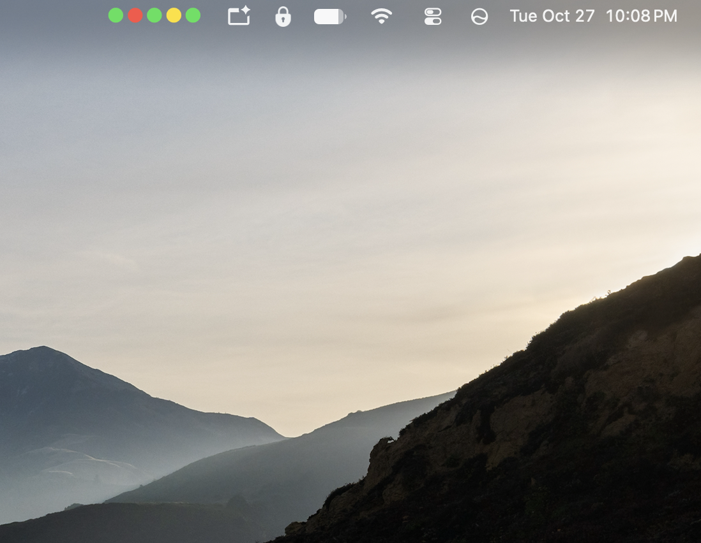

# Agent Monitor

macOS menu bar app showing one colored dot per active coding agent — **Claude Code**
and **Codex CLI** sessions running in iTerm2.



- 🟢 **green** — working
- 🟡 **yellow** — attention needed (permission prompt / waiting on you)
- 🔴 **red** — stopped (turn done, idle, interrupted, or error)
- 🟠 **orange** — stalled (see below)
- ○ gray hollow — no active agent sessions

Each agent gets its own shape so you can tell them apart in the bar:
**●** Claude Code, **◆** Codex, **■** anything else (switchable to all-circles
in Settings).

Click the dots for a dropdown listing each agent (`project · claude — working  4m`,
`project · codex — waiting  12s`, …) with how long it has been in that state.
Clicking an agent focuses its iTerm2 session and brings iTerm2 forward; while the
menu is open, keys `1`–`9` pick a row.

- **Notifications**: a macOS notification when an agent needs attention or
  finishes a turn (each togglable in Settings). Clicking it focuses the session.
  macOS asks once for notification permission on first launch.
- **Global shortcut** `⌃⌥A`: focuses the next agent waiting on you, cycling
  through them; with none waiting, cycles through all agents. Can be disabled
  in Settings.
- **Hide stopped sessions**: Settings can age stopped (red) sessions out of
  the bar after 1–60 minutes; the dropdown shows how many are hidden.
- **Stall detection**: a working agent turns orange, and you get a
  notification, when either its terminal has printed nothing for 90 s (both
  agents animate a spinner during a turn, so silence means the process is
  wedged — detected via the tty's modification time) or the turn has run for
  longer than a configurable limit (default 15 min, off/5–60 in Settings).
  The dropdown says which: `— stalled (no output for 2m)` or
  `— stalled (working for 22m)`.

Dot colors are customizable: **Settings…** in the dropdown opens a window with a
color well per state (working / attention needed / stopped / stalled) and a reset button.
Changes apply immediately and persist across restarts (stored in `UserDefaults`;
inspect with `defaults read AgentMonitor`, wipe with `defaults delete AgentMonitor`).

## How it works

The app installs no hooks of its own. Both agents push their state into iTerm2's
generic per-session status store (`it2 session set-status`), and the app polls it:

```
Claude Code ── cc-status (bundled with iTerm2, ──┐
               wired in ~/.claude/settings.json) │
                                                 ├──▶ iTerm2 status store ──▶ AgentMonitor
Codex CLI ──── codex/codex-status (this repo, ───┘         (per session)       (menu bar)
               wired in ~/.codex/hooks.json)
```

Every 2 seconds the app runs, via iTerm2's bundled CLI:

```
it2 session list --json          # all sessions + working directory + foreground job
it2 session get-status -s <id>   # {"status": "working|waiting|done|idle|error", ...}
```

A session gets a dot only if an agent has registered a status for it. Sessions
whose foreground job has dropped back to a plain shell are skipped — the agent
exited, so its stale status is ignored.

### Status mapping

| Agent event                                | iTerm2 status | Dot |
|--------------------------------------------|---------------|-----|
| prompt submitted, tool ran, compaction     | `working`     | 🟢  |
| permission requested                       | `waiting`     | 🟡  |
| turn finished                              | `done`        | 🔴  |
| session start/end, interrupted             | `idle`        | 🔴  |
| failure                                    | `error`       | 🔴  |

The status→state mapping lives in `DotState(status:)` at the top of
`AgentMonitor.swift` (colors themselves come from `ColorStore`, overridable in
Settings); the Codex event→status mapping in `codex/codex-status`.

## Requirements

- macOS with Xcode Command Line Tools (`swiftc`)
- iTerm2 (both agents must run inside it — that's where the status store lives),
  with its Python API enabled (Settings → General → Magic → Enable Python API),
  which the `it2` CLI uses
- For Claude Code: iTerm2's Claude Code integration — the `cc-status` utility
  bundled with iTerm2, registered for every Claude Code hook event in
  `~/.claude/settings.json`. Check that file for `cc-status` entries; if they're
  missing, look for the Claude Code / AI integration option in your iTerm2
  version's settings.
- For Codex: Codex CLI with lifecycle hooks support

Verified against iTerm2 3.7.6, Codex CLI 0.160.0, and Claude Code as of
October 2026.

## Install

```sh
./install.sh
```

This builds `AgentMonitor.app`, installs the Codex hook (`~/.codex/hooks/codex-status` +
`~/.codex/hooks.json`), and registers a LaunchAgent so the app starts at login.

If you already have a `~/.codex/hooks.json`, the installer leaves it untouched —
merge the `codex-status` entries in yourself (register it for `SessionStart`,
`UserPromptSubmit`, `PostToolUse`, `PermissionRequest`, `Stop`, `Interrupt`,
and `SessionEnd`).

### Codex one-time trust step

Codex only runs lifecycle hooks it trusts (they execute outside its sandbox).
After installing or changing the hook, start `codex` interactively once — it
shows a **"Hooks need review"** prompt — and choose **Trust all and continue**
(also manageable later via `/hooks` in the TUI). Until then Codex silently
skips the hook and no Codex dots appear.

## Maintenance

```sh
./install.sh                                                   # rebuild + restart after changes
launchctl kickstart -k gui/$UID/com.forloops.agent-monitor     # just restart
./uninstall.sh                                                 # stop + remove
```

## Troubleshooting

- **No notifications**: System Settings → Notifications → Agent Monitor must be
  allowed, and the app must be running from `AgentMonitor.app` (rerun
  `./install.sh`; `/tmp/agent-monitor.log` says "not running from an app bundle"
  otherwise).
- **No dots at all** (not even ○): check `/tmp/agent-monitor.log` and that the
  LaunchAgent is loaded: `launchctl print gui/$UID/com.forloops.agent-monitor`.
- **"iTerm2 not reachable" while iTerm2 is running**: enable iTerm2's Python API
  (Settings → General → Magic → Enable Python API) and approve the connection if
  iTerm2 prompts for it.
- **Claude session shows no dot**: confirm iTerm2's cc-status hooks exist in
  `~/.claude/settings.json` and the session runs inside iTerm2.
- **Codex session shows no dot**: check `/tmp/agent-monitor-codex.log` — if it's
  empty while Codex runs, the hook isn't trusted yet (see the trust step above).
- **Inspect a session's stored status directly**:
  `it2 session get-status -s <session-id>` (ids from `it2 session list`).

## Project layout

```
AgentMonitor.swift    # the menu bar app (single file, no dependencies)
AgentMonitor.app/     # built by install.sh (gitignored)
codex/codex-status    # Codex lifecycle hook -> it2 session set-status
install.sh            # build + install hook, hooks.json, LaunchAgent
uninstall.sh          # remove LaunchAgent + Codex hook
```

## Limitations

- iTerm2 only — sessions in other terminals won't appear.
- Status granularity is whatever the hooks report; there's no heartbeat beyond
  hook events, so a crashed agent process is caught by the foreground-job check
  rather than a timeout.
- Codex lifecycle hooks are a new and still-evolving Codex feature (event names,
  payloads, and the trust flow were verified against Codex CLI 0.160.0); expect
  the integration to need occasional updates as Codex changes.
